


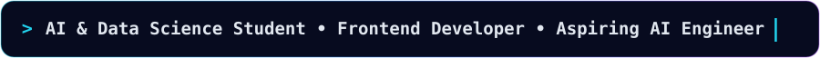

 

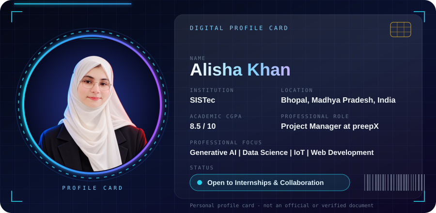

<h2 align="center">About Me</h2>

> I'm Alisha Khan, an AI & Data Science student at SISTec with a strong interest in Generative AI, IoT, Data Science, and software development. I enjoy exploring emerging technologies, building practical applications, and learning through hands-on projects. I'm eager to connect with experienced professionals worldwide, exchange knowledge, collaborate on innovative projects, and explore internship opportunities.

<h2 align="center">Statistics Dashboard</h2>


<h2 align="center">Technical Skills</h2>

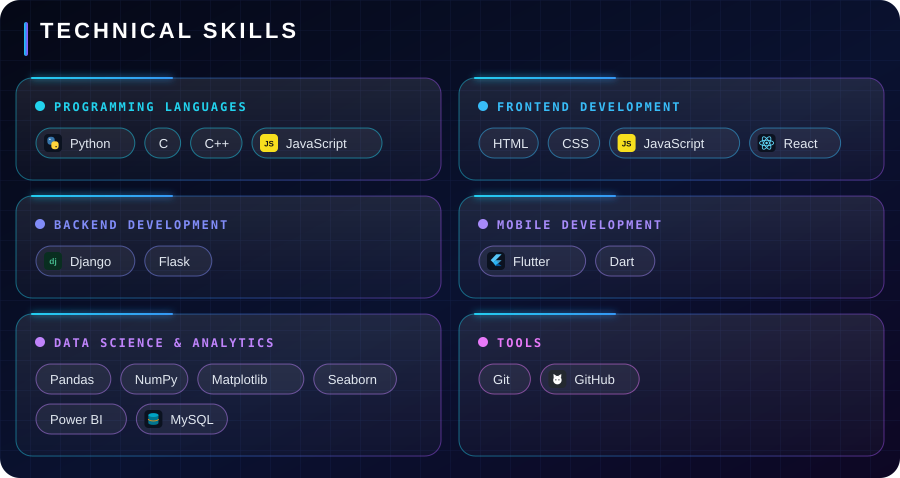

<h2 align="center">Professional Experience & Affiliations</h2>

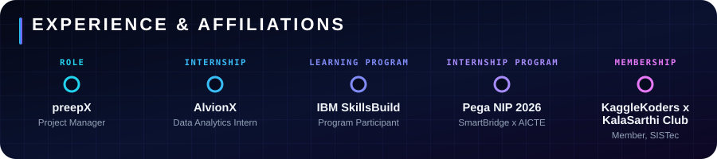

<table width="100%">
<tr>
<th align="left">Type</th>
<th align="left">Organization</th>
<th align="left">Role / Program</th>
<th align="left">Highlights</th>
</tr>
<tr>
<td><b>Professional Role</b></td>
<td><b>preepX</b></td>
<td>Project Manager</td>
<td>• Coordinate Campus Ambassador Program activities • Assign tasks and communicate with campus ambassadors • Monitor participation and team progress • Support team engagement and program coordination</td>
</tr>
<tr>
<td><b>Internship</b></td>
<td><b>AlvionX</b></td>
<td>Data Analytics Intern</td>
<td>• Data Analytics Internship</td>
</tr>
<tr>
<td><b>Learning Program</b></td>
<td><b>IBM SkillsBuild</b></td>
<td>Internship Program Participant</td>
<td>• Participating in the IBM SkillsBuild learning program • Exploring technical learning resources and industry-relevant technologies A learning-program association, not employment at IBM.</td>
</tr>
<tr>
<td><b>Internship Program</b></td>
<td><b>Pega</b></td>
<td>Pega National Internship Program (NIP) 2026</td>
<td>• Participated through SmartBridge and AICTE • Gained exposure to low-code application development</td>
</tr>
<tr>
<td><b>Membership</b></td>
<td><b>KaggleKoders × KalaSarthi Club, SISTec</b></td>
<td>Member</td>
<td>• Member of a student technology community • Interested in collaborative learning and practical data science applications</td>
</tr>
</table>

<h2 align="center">Projects</h2>

<a href="https://github.com/alishaaakhan">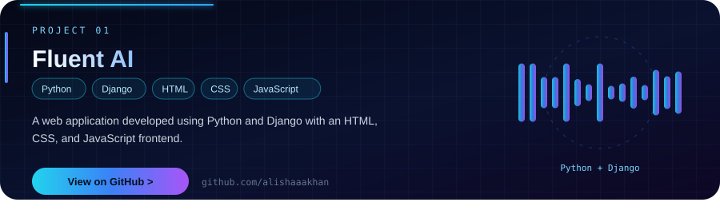</a>

 

<a href="https://github.com/alishaaakhan">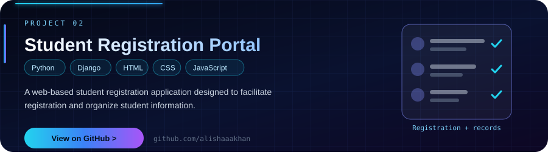</a>

 

<a href="https://github.com/alishaaakhan">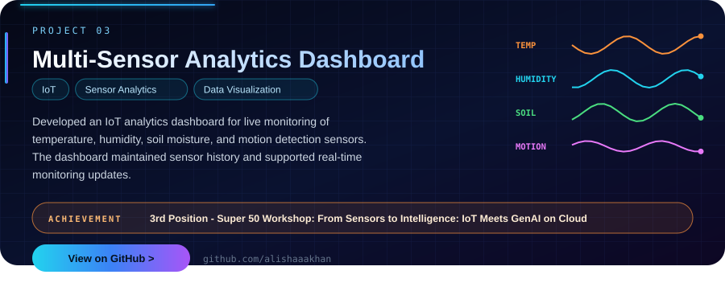</a>

Project cards currently link to my <a href="https://github.com/alishaaakhan">GitHub profile</a>. Individual repository links will be added as projects are published.

<h2 align="center">Achievements & Recognition</h2>

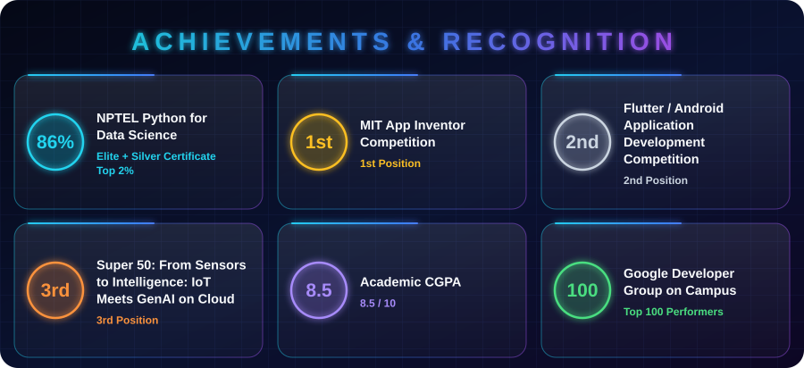

<h2 align="center">Hobbies & Interests</h2>

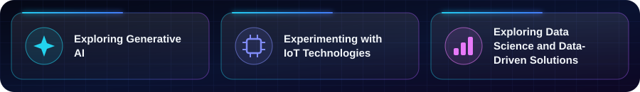

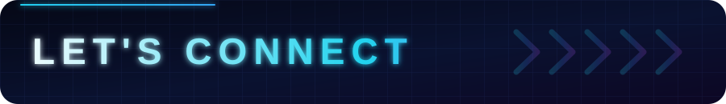

<table width="100%">
<tr>
<td width="46%" align="center" valign="middle">

</td>
<td width="54%" valign="middle">

<h3>LET'S BUILD SOMETHING MEANINGFUL.</h3>

I'm always excited to connect with experienced professionals, developers, AI enthusiasts, and people who enjoy solving real-world problems through technology. I'm open to internships, collaborative projects, knowledge sharing, and opportunities to learn from a global tech community.

 

 

</td>
</tr>
</table>

**Have an idea, internship opportunity, or collaboration in mind? Let's connect!**

`Open to Internships • Collaborative Projects • Global Professional Connections`

 

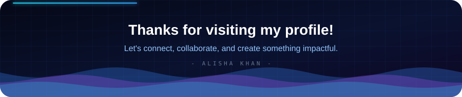

<a href="https://github.com/alishaaakhan">GitHub</a> • <a href="https://www.linkedin.com/in/alishaa-khan/">LinkedIn</a> • <a href="mailto:alishak1280@gmail.com">Email</a>

